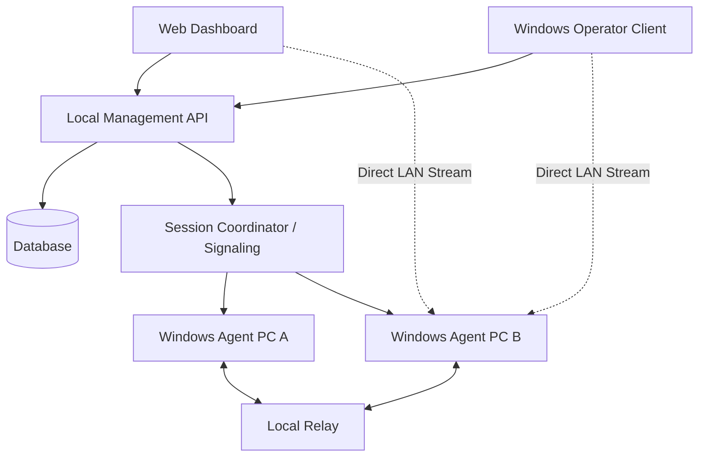
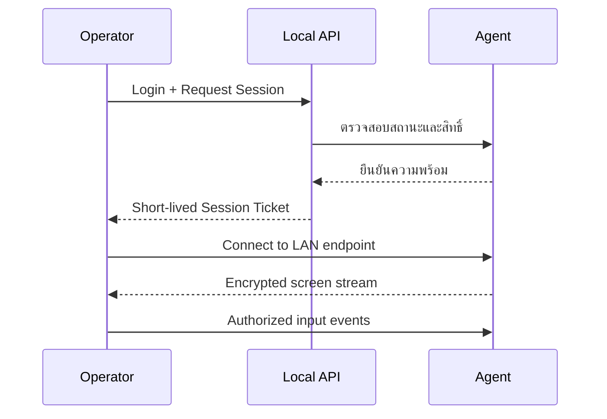
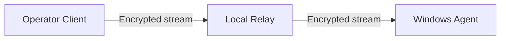

# LAN First Remote Desktop — Architecture V1

เอกสารออกแบบระบบ Remote Desktop ที่เริ่มจาก LAN และเตรียมขยายเป็น Internet Remote ใน V2

- Client: Web Dashboard + Windows Operator Client
- LAN: Hybrid — Direct IP + Local Server Relay
- ชุดทดสอบ: 2 เครื่อง
- เป้าหมายระยะยาว: มากกว่า 300 Devices และควบคุมพร้อมกันสูงสุด 5 Sessions

## 1. เป้าหมาย V1

- ลงทะเบียนและจัดการ Windows PC ปลายทาง
- แสดง Online / Offline, ชื่อเครื่อง, สาขา และ Agent version
- เริ่ม Session จาก Web Dashboard หรือ Windows Client
- ดูหน้าจอแบบ Real-time และควบคุม Mouse / Keyboard
- รองรับ Direct LAN และ Local Relay
- มี Authentication, Authorization, Encryption และ Audit Log
- จำกัด Session พร้อมกันสูงสุด 5 โดย Backend เป็นผู้ควบคุม
- แยก Transport ออกจาก Remote Desktop Core เพื่อเพิ่ม Internet Transport ภายหลัง

ยังไม่รวมใน V1: Internet Remote, File Transfer, Audio, Clipboard, Session Recording, Mobile Control และ Multi-monitor ขั้นสูง

## 2. หลักการออกแบบ

1. ใช้ Device ID (UUID) เป็นตัวตนของเครื่อง ไม่ใช้ IP เป็นรหัสประจำเครื่อง
2. แยก Module ตามหน้าที่ ใช้ Shared Contracts และลด dependency โดยตรง
3. Web Dashboard ใช้ API เท่านั้น ห้ามเชื่อม Database โดยตรง
4. Direct LAN และ Relay ต้องใช้ Authentication / Authorization / Encryption เหมือนกัน
5. LAN ไม่ได้แปลว่าปลอดภัย ห้ามเปิดพอร์ตควบคุมสู่ Public Internet
6. Unattended Access ต้องได้รับอนุญาตล่วงหน้าจากผู้มีอำนาจ และแสดงสถานะ Remote Session บนเครื่องปลายทาง

## 3. Architecture Overview



### Components

| Component | หน้าที่ |
|---|---|
| Web Dashboard | จัดการองค์กร สาขา เครื่อง ผู้ใช้ สิทธิ์ และเริ่ม Session |
| Windows Operator Client | โปรแกรมเจ้าหน้าที่สำหรับ Remote Viewer |
| Windows Agent | ลงทะเบียนเครื่อง ส่ง heartbeat จับภาพและรับ input |
| Local Management API | API สำหรับผู้ใช้ อุปกรณ์ สิทธิ์ และสถานะ |
| Signaling / Session Coordinator | จับคู่ Operator กับ Device และจอง Session |
| Local Relay | ส่งต่อ encrypted stream เมื่อ Direct LAN ใช้ไม่ได้ |
| Database | เก็บข้อมูลอุปกรณ์ ผู้ใช้ Session และ Audit |

ชุดทดลองสามารถรัน API, Signaling และ Relay บน Local Server เครื่องเดียวกันได้ แต่แยก Process/Module ให้ชัดเจน

## 4. Hybrid LAN

### Mode A — Direct LAN



ใช้เมื่อ Operator เข้าถึง Agent ผ่าน LAN ได้โดยตรง ข้อดีคือ latency ต่ำและไม่ต้องส่งภาพผ่าน Server

### Mode B — Local Server Relay



ใช้เมื่ออยู่คนละ subnet หรือ Firewall ไม่อนุญาต Direct Connection ข้อดีคือควบคุมเส้นทางได้ง่าย แต่ Server รับภาระ bandwidth และเพิ่ม latency

### Connection Policy

1. ขอ Session จาก API ก่อนเสมอ
2. ตรวจสิทธิ์และจอง Session slot
3. ลอง Direct LAN ตามนโยบาย
4. หากไม่ได้ ให้ fallback ไป Local Relay
5. หากทั้งสองทางไม่ได้ ให้ยกเลิก reservation และแจ้งสาเหตุ
6. Session Ticket ต้องมีอายุสั้นและผูกกับ Operator, Device และ Session

## 5. Module Architecture

| Module | ความรับผิดชอบ |
|---|---|
| Contracts | DTO, interfaces, protocol contracts |
| Domain | Entities และ business rules |
| Application | Use cases และ orchestration |
| Infrastructure | Database, logging, configuration |
| API | REST API และ authentication |
| Signaling | Presence, negotiation, session coordination |
| Relay | รับส่ง stream แบบ encrypted |
| Agent.Service | Windows Service, identity, heartbeat |
| Agent.Interactive | Screen capture และ input ใน user session |
| Operator.Windows | Windows operator application |
| Dashboard | Web UI |
| Transport.Abstractions | สัญญาการเชื่อมต่อกลาง |
| Transport.DirectLan | Direct LAN implementation |
| Transport.LocalRelay | Relay implementation |

### Windows Agent: Service + Interactive Worker

Windows Service ทำงานใน Session 0 จึงไม่ควรจับภาพ Desktop ของผู้ใช้โดยตรง

**Agent Service**
- เริ่มอัตโนมัติเมื่อ Windows เริ่ม
- ลงทะเบียน Device และส่ง heartbeat
- ตรวจสอบคำสั่งและ policy
- เปิด/ปิด Interactive Worker อย่างปลอดภัย

**Interactive Worker**
- ทำงานใน Windows user session ที่ได้รับอนุญาต
- จับภาพหน้าจอ
- รับ Mouse / Keyboard input
- สื่อสารกับ Service ผ่าน IPC ที่จำกัดสิทธิ์

UAC / Secure Desktop เป็นข้อจำกัดแยกต่างหาก ต้องทดสอบและระบุขอบเขต ไม่ควรอ้างว่าควบคุมได้ครบใน V1

### Transport Contract (ตัวอย่าง)

```csharp
public interface IRemoteTransport
{
    Task<TransportConnectionResult> ConnectAsync(
        SessionConnectionInfo session,
        CancellationToken cancellationToken);

    Task DisconnectAsync(CancellationToken cancellationToken);
}
```

Internet V2 สามารถเพิ่ม `WebRtcTransport` โดยไม่เปลี่ยน Session Core

## 6. Technology Stack

| ส่วน | เทคโนโลยี |
|---|---|
| Backend | ASP.NET Core / .NET LTS |
| Agent | C# / .NET Worker Service + Windows APIs |
| Windows Operator | WPF หรือ WinUI 3 |
| Dashboard | Next.js + TypeScript |
| API / Signaling | REST + WebSocket |
| LAN Transport | Encrypted TCP baseline; ประเมิน WebRTC เพิ่มจากผลทดสอบ |
| Relay | .NET service แยก |
| Pilot Database | SQLite |
| ระยะขยาย | PostgreSQL |
| CI | GitHub Actions |

Screen streaming ต้องเลือก codec, frame rate และ bitrate จากผลทดสอบจริง อย่าส่ง PNG เต็มหน้าจอทุกเฟรมเป็นแนวทางหลัก ค่าเริ่มทดสอบแนะนำ 1280×720 ที่ 10–15 FPS แล้ววัด latency, CPU, memory และ bandwidth

## 7. Data Model เบื้องต้น

- `organizations`: id, name, status
- `sites`: id, organization_id, name, status
- `users`: id, organization_id, email, display_name, status
- `roles` / `user_roles`: บทบาทและสิทธิ์
- `devices`: id, organization_id, site_id, hostname, agent_version, public_key, last_seen_at, status
- `device_endpoints`: device_id, endpoint_type, address, port, last_verified_at
- `device_permissions`: device_id, user_id/role_id, permission, approved_by, approved_at, expires_at
- `sessions`: id, organization_id, device_id, operator_user_id, transport_type, status, started_at, ended_at, end_reason
- `audit_logs`: organization_id, actor_user_id, device_id, session_id, action, result, source_ip, created_at

ทุก API ต้องตรวจสอบ organization scope และ permission ฝั่ง Server ไม่เชื่อ ID ที่ Client ส่งมาโดยไม่ตรวจสอบ

## 8. Security Model

- Operator login ด้วยบัญชีของตนเอง
- MFA สำหรับผู้ดูแล
- Agent มี Device identity ที่เพิกถอนได้
- Unattended Access ต้องอนุมัติล่วงหน้าโดยผู้มีอำนาจ
- จำกัดสิทธิ์ตามองค์กร สาขา อุปกรณ์ และบทบาท
- Session Ticket อายุสั้น ผูกกับผู้ใช้/อุปกรณ์/session
- TLS สำหรับ API/Signaling และ encryption สำหรับ stream
- ไม่เก็บรหัสผ่าน Windows ของลูกค้า
- มีปุ่ม Disable Remote Access / Disconnect
- Audit log บันทึกผู้เริ่ม เวลา เครื่อง เส้นทาง และผลลัพธ์
- ป้องกัน replay, brute force และ session reuse
- ห้ามทำ hidden mode หรือหลบเลี่ยงการแสดงสถานะการควบคุม

## 9. Session Coordinator — สูงสุด 5 Sessions

Backend ต้องจอง Session slot แบบ atomic ห้ามนับจาก Dashboard เพราะเกิด race condition ได้

```text
Request -> Authenticate -> Authorize Device -> Check Availability
        -> Atomic Reserve Slot (0..4) -> Issue Ticket
        -> Connect Direct / Relay -> Active Session
        -> End / Timeout / Disconnect -> Release Slot
```

- `MAX_CONCURRENT_SESSIONS = 5` ตั้งค่าฝั่ง Server
- ใช้ heartbeat / lease และ timeout
- คืน slot เมื่อ Session จบหรือ lease หมดอายุ
- ใช้ idempotency key ป้องกันการสร้าง Session ซ้ำ
- Pilot เครื่องเดียวเริ่มด้วย database transaction ได้
- เมื่อขยายหลาย Backend instance ค่อยใช้ Redis หรือ distributed lease ที่เหมาะสม

## 10. Network / Port Plan

ตัวเลขต่อไปนี้เป็นตัวอย่าง ต้องตรวจสอบ Firewall ก่อนเปิดใช้

| Service | ตัวอย่างพอร์ต | การเข้าถึง |
|---|---:|---|
| HTTPS API / Dashboard | 443 | Operator → Local Server |
| WebSocket Signaling | 443 ผ่าน reverse proxy | Operator / Agent → Server |
| Direct Agent Stream | 52000–52010 | Operator → Agent เฉพาะ LAN |
| Local Relay | 52100 | Operator / Agent → Relay |

ห้ามเปิด Direct Agent Stream สู่ Internet และไม่ใช้ Router port forwarding ใน V1 จำกัด source subnet ด้วย Firewall

## 11. GitHub Repository Structure

แนะนำ Monorepo ในช่วงเริ่มต้น เพื่อให้ Contracts และ Protocol เปลี่ยนพร้อมกันได้

```text
remote-desktop-platform/
├─ README.md
├─ LICENSE
├─ .gitignore
├─ .editorconfig
├─ global.json
├─ Directory.Build.props
├─ Directory.Packages.props
├─ docs/
│  ├─ 00-project-overview.md
│  ├─ 01-requirements-v1.md
│  ├─ 02-architecture-v1.md
│  ├─ 03-network-design.md
│  ├─ 04-security-model.md
│  ├─ 05-database-design.md
│  ├─ 06-session-lifecycle.md
│  ├─ 07-agent-installation.md
│  ├─ 08-local-development.md
│  ├─ 09-testing-plan.md
│  ├─ 10-roadmap.md
│  └─ adr/
│     ├─ 0001-monorepo.md
│     ├─ 0002-lan-hybrid-transport.md
│     └─ 0003-agent-service-worker.md
├─ src/
│  ├─ backend/
│  │  ├─ RemoteDesk.Api/
│  │  ├─ RemoteDesk.Application/
│  │  ├─ RemoteDesk.Domain/
│  │  ├─ RemoteDesk.Infrastructure/
│  │  ├─ RemoteDesk.Contracts/
│  │  ├─ RemoteDesk.Signaling/
│  │  └─ RemoteDesk.Relay/
│  ├─ agent/
│  │  ├─ RemoteDesk.Agent.Service/
│  │  ├─ RemoteDesk.Agent.Interactive/
│  │  └─ RemoteDesk.Agent.Contracts/
│  ├─ operator/
│  │  └─ RemoteDesk.Operator.Windows/
│  ├─ dashboard/
│  │  └─ remotedesk-dashboard/
│  └─ transports/
│     ├─ RemoteDesk.Transport.Abstractions/
│     ├─ RemoteDesk.Transport.DirectLan/
│     └─ RemoteDesk.Transport.LocalRelay/
├─ tests/
│  ├─ unit/
│  ├─ integration/
│  └─ e2e/
│     └─ lan-two-pc/
├─ deploy/
│  ├─ local-server/
│  ├─ windows-agent/
│  ├─ firewall/
│  └─ scripts/
├─ tools/
│  ├─ diagnostics/
│  └─ test-stream-generator/
└─ .github/
   ├─ workflows/
   │  ├─ backend-ci.yml
   │  ├─ agent-ci.yml
   │  └─ dashboard-ci.yml
   ├─ ISSUE_TEMPLATE/
   └─ pull_request_template.md
```

### Dependency Rules

- Domain ไม่อ้าง Infrastructure หรือ UI
- Application อ้าง Domain และ Contracts
- Infrastructure implement interfaces ที่กำหนดไว้
- API เรียก Application
- Dashboard ติดต่อ API เท่านั้น
- Agent ใช้ Agent.Contracts และ Transport abstractions
- Transport implementations implement abstraction กลาง
- ห้าม Agent เชื่อคำสั่งควบคุมที่ไม่มี Session authorization

## 12. V1 Screens

### Web Dashboard
1. Login
2. Overview: จำนวนเครื่อง / Online / Offline / Active Sessions
3. Organizations
4. Sites / Branches
5. Devices: ค้นหาและกรอง
6. Device Detail: ข้อมูลเครื่องและสิทธิ์
7. Start Remote Session
8. Active Sessions
9. Users & Roles
10. Audit Logs
11. Settings

### Windows Operator Client
1. Login
2. Device List / Search
3. Connect
4. Remote Viewer
5. Toolbar: Fullscreen, Quality, Disconnect
6. แสดง Direct LAN / Relay และสถานะการเชื่อมต่อ

### Windows Agent
- แสดงองค์กร/สาขา/ชื่ออุปกรณ์
- สถานะ Online และ Remote Session
- แสดงผู้ควบคุมและเวลาเริ่ม
- ปุ่ม Disconnect / Disable Remote Access
- Enrollment และถอนการลงทะเบียน

## 13. ทดสอบด้วย 2 เครื่อง

- PC-A: Local Server + Operator Client
- PC-B: Windows Agent
- ติดตั้ง Agent บน PC-A เพิ่มได้ภายหลังเพื่อทดสอบ self-device แต่ไม่จำเป็นสำหรับ flow แรก

| ID | Test | Expected |
|---|---|---|
| T01 | Agent enrollment | ได้ Device ID ไม่ซ้ำ |
| T02 | Heartbeat | Dashboard แสดง Online / Offline ถูกต้อง |
| T03 | Operator login | ผ่าน Authentication |
| T04 | ไม่มีสิทธิ์เข้าเครื่อง | ปฏิเสธและบันทึก Audit |
| T05 | Direct LAN | ดูภาพหน้าจอได้ |
| T06 | Mouse / Keyboard | ควบคุมได้ตามสิทธิ์ |
| T07 | Direct ใช้ไม่ได้ | fallback Relay ได้ |
| T08 | Network หลุด | ปิด/หมด lease และคืน slot |
| T09 | Request ซ้ำ | ไม่สร้าง Session ซ้ำ |
| T10 | Session limit | Session ที่ 6 ถูกปฏิเสธ |
| T11 | Revoke device | เชื่อมต่อใหม่ไม่ได้ |
| T12 | Audit | ตรวจสอบผู้ใช้ เครื่อง เวลา และผลได้ |

ทดสอบ Session limit ด้วย simulated clients/automated tests ได้ ไม่จำเป็นต้องมี PC จริง 6 เครื่อง

## 14. Roadmap

### Phase 0 — Foundation
- [ ] สร้าง Monorepo
- [ ] ตั้งค่า .NET SDK / Node.js
- [ ] ตั้ง formatter, analyzers และ CI
- [ ] สร้าง Contracts / Domain / Application
- [ ] เขียน ADR

ผลลัพธ์: Build ผ่านบนเครื่อง Developer และ GitHub Actions

### Phase 1 — Device Enrollment
- [ ] Local API
- [ ] Device registration และ identity
- [ ] Agent heartbeat
- [ ] Dashboard Device List
- [ ] Disable / revoke device

ผลลัพธ์: PC-B ปรากฏ Online บน Dashboard

### Phase 2 — Direct LAN Screen View
- [ ] Direct LAN handshake
- [ ] Session Ticket validation
- [ ] Encrypted channel
- [ ] Screen capture worker
- [ ] ส่งภาพไป Operator
- [ ] วัด latency / FPS / bandwidth

ผลลัพธ์: PC-A ดูหน้าจอ PC-B ได้

### Phase 3 — Input Control
- [ ] Mouse movement / click
- [ ] Keyboard input
- [ ] Permission gate
- [ ] Disconnect
- [ ] แสดงสถานะ Remote Session ที่ Agent

ผลลัพธ์: PC-A ควบคุม PC-B ได้ตามสิทธิ์

### Phase 4 — Local Relay
- [ ] Relay Service
- [ ] Relay handshake
- [ ] Direct → Relay fallback
- [ ] ทดสอบ subnet / firewall scenarios

ผลลัพธ์: ใช้ได้ทั้ง Direct และ Relay

### Phase 5 — Session & Security
- [ ] Atomic Session Coordinator จำกัด 5
- [ ] Heartbeat / lease / timeout
- [ ] RBAC
- [ ] Audit Logs
- [ ] MFA สำหรับผู้ดูแล
- [ ] Security testing

ผลลัพธ์: ควบคุม Session และสิทธิ์ได้ตามข้อกำหนด

### Phase 6 — Pilot Release
- [ ] ติดตั้ง Agent บน 2 เครื่อง
- [ ] ทดสอบต่อเนื่องและ network interruption
- [ ] เก็บ performance baseline
- [ ] คู่มือติดตั้ง/แก้ปัญหา
- [ ] Tag `v1.0.0-lan-pilot`

ผลลัพธ์: LAN Pilot พร้อมขยายทดสอบ

## 15. Definition of Done

V1 ผ่านเมื่อ:
- Agent ลงทะเบียนและ revoke ได้
- Dashboard แสดงสถานะเครื่อง
- Direct LAN และ Relay ใช้งานได้
- ดูหน้าจอและควบคุม Mouse / Keyboard ได้
- ผู้ไม่มีสิทธิ์เริ่ม Session ไม่ได้
- เครื่องปลายทางแสดงสถานะ Remote Session
- จำกัด 5 Sessions แบบ atomic
- เมื่อหลุด ระบบคืน slot ได้
- Audit Log ตรวจสอบย้อนหลังได้
- Build และ automated tests ผ่าน

## 16. งานที่ควรเริ่มในสัปดาห์แรก

1. สร้าง GitHub Repository ตามโครงสร้างนี้
2. สร้าง .NET Solution และ Dashboard เปล่า
3. กำหนด DTO / interface ใน Contracts
4. ทำ Local API และ Device enrollment
5. ทำ Windows Agent heartbeat
6. ทำ Dashboard แสดง PC-A / PC-B
7. เริ่ม Screen Capture และ Direct LAN stream หลัง identity/session flow ทำงานแล้ว

อย่าเริ่มจาก Remote Viewer ก่อน Device identity, Session authorization และ Transport contract เพราะจะต้องรื้อเมื่อเพิ่ม Relay หรือ Internet Remote

## 17. Internet Remote ใน V2

เมื่อ LAN V1 เสถียร ค่อยเพิ่ม:
- Internet Signaling endpoint
- WebRTC transport
- STUN / TURN (เช่น coturn)
- Agent outbound secure connection
- Central PostgreSQL และ Redis เมื่อจำเป็น
- Monitoring / alerting / agent auto-update

Reuse จาก V1: Device ID, enrollment, users/organizations/sites, Session Coordinator, authorization, audit, screen/input core และ `IRemoteTransport`

เพิ่มใน V2: Internet transport, signaling deployment, TURN infrastructure และ NAT traversal policy

## 18. สรุปการตัดสินใจ

- Monorepo
- ASP.NET Core backend
- C# Windows Agent แยก Service และ Interactive Worker
- Next.js Web Dashboard
- Windows Operator Client
- Hybrid LAN: Direct IP + Local Relay
- SQLite สำหรับ Pilot; เตรียมเปลี่ยน PostgreSQL เมื่อขยาย
- Server-side Session Coordinator จำกัด 5 sessions
- Security และ Audit เป็นส่วนหนึ่งของ V1
- Internet Remote เป็น V2 ผ่าน Transport abstraction เดิม

**ลำดับหลัก:** Device Enrollment → Direct LAN Screen View → Mouse/Keyboard Control → Relay → Session Limit & Security → Pilot Release
