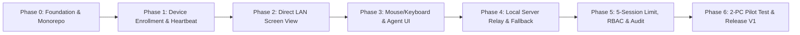

# แผนการดำเนินงานและโรดแมพ (Implementation Plan & Roadmap) — RemoteDesk V1 (LAN-First)

เอกสารนี้ขยายความจาก [LAN_First_Remote_Desktop_Architecture_V1.md](./LAN_First_Remote_Desktop_Architecture_V1.md) เพื่อวางแผนการพัฒนาระบบ Remote Desktop แบบ LAN-First (Hybrid: Direct LAN + Local Relay) อย่างเป็นระบบ พร้อมลำดับขั้นตอนที่ชัดเจนก่อนเริ่มลงมือเขียนโค้ด

---

## 1. สรุปกรอบงานและกฎเหล็ก (Core Principles & Constraints)

1. **ลำดับการพัฒนาที่ห้ามข้าม (Strict Order):**
   - ต้องทำ **Device Identity -> Session Authorization -> Transport Contract** ให้เสร็จก่อนเริ่มทำ **Screen Capture / Remote Viewer**
2. **สถาปัตยกรรม Monorepo & Dependency Rules:**
   - `Domain` ไม่พึ่งพาไลบรารีภายนอกหรือ `Infrastructure` / `UI`
   - `Application` อ้างอิงเฉพาะ `Domain` และ `Contracts`
   - `Dashboard` (Next.js) เรียกผ่าน `RemoteDesk.Api` เท่านั้น ห้ามต่อฐานข้อมูลตรง
   - `Agent` แยกเป็น 2 ส่วนเสมอ: `Agent.Service` (Session 0: Identity, Heartbeat, Policy, IPC) และ `Agent.Interactive` (User Session: Screen Capture, Mouse/Keyboard Input)
   - `Transport` ทุกตัว (`DirectLan`, `LocalRelay`, และ `WebRtc` ในอนาคต) ต้อง Implement `IRemoteTransport`
3. **การควบคุมจำนวน Session (Session Coordinator):**
   - จำกัด `MAX_CONCURRENT_SESSIONS = 5` แบบ Atomic ฝั่ง Backend (ใช้ Database Transaction ในช่วง Pilot SQLite พร้อม Lease/Heartbeat Timeout และ Idempotency Key)
4. **ความปลอดภัย (Security First):**
   - ใช้ `Device ID (UUID)` เป็นตัวตนหลัก ไม่ผูกติดกับ IP
   - บังคับใช้ Short-lived Session Ticket, TLS/Encryption ทุกช่องทาง และแสดงสถานะการควบคุมบนเครื่องปลายทางเสมอ (ห้ามมี Hidden Mode)

---

## 2. แผนผังลำดับการพัฒนา (Development Roadmap Flow)

---

## 3. แผนงานละเอียดรายเฟส (Detailed Phase Breakdown)

### Phase 0 — Foundation & Monorepo Setup
**เป้าหมาย:** สร้างโครงสร้างโปรเจกต์มาตรฐาน ตั้งค่า Build/Formatting/CI และวางโครงสร้าง Clean Architecture + Shared Contracts ให้ Build ผ่านทั้งหมด

| รหัสงาน | รายละเอียดงาน | ผลลัพธ์ / ไฟล์หลัก |
|---|---|---|
| `P0-01` | สร้างโครงสร้างโฟลเดอร์ Monorepo (`src/`, `tests/`, `docs/`, `deploy/`, `tools/`) และไฟล์พื้นฐาน (`.gitignore`, `.editorconfig`, `README.md`) | โครงสร้างโฟลเดอร์ครบตามสเปก |
| `P0-02` | ตั้งค่า `.NET Solution` (`RemoteDesk.sln`), `global.json`, `Directory.Build.props`, `Directory.Packages.props` | รัน `dotnet build` ที่ root ได้ |
| `P0-03` | สร้างโปรเจกต์ฝั่ง Backend (`Domain`, `Contracts`, `Application`, `Infrastructure`, `Api`, `Signaling`, `Relay`) และผูก Project References ตามกฎ Dependency | โครงสร้างโปรเจกต์ Backend ครบ |
| `P0-04` | สร้างโปรเจกต์ฝั่ง Transport (`Transport.Abstractions`, `Transport.DirectLan`, `Transport.LocalRelay`), Agent (`Agent.Contracts`, `Agent.Service`, `Agent.Interactive`) และ Operator (`Operator.Windows`) | โครงสร้างโปรเจกต์ Client/Agent ครบ |
| `P0-05` | สร้างโปรเจกต์ Web Dashboard (`src/dashboard/remotedesk-dashboard`) ด้วย Next.js + TypeScript | รัน `npm run build` ผ่าน |
| `P0-06` | ออกแบบและเขียน Shared Contracts เบื้องต้น (`IRemoteTransport`, `SessionConnectionInfo`, `DeviceDtos`, `SessionDtos`) และ Domain Entities หลัก (10 ตารางตาม Data Model) | คลาสและ Interface พื้นฐานพร้อมใช้งาน |
| `P0-07` | บันทึกเอกสารสถาปัตยกรรมตั้งต้น (`docs/`) และ ADR 3 ฉบับ (`0001-monorepo.md`, `0002-lan-hybrid-transport.md`, `0003-agent-service-worker.md`) + ตั้งค่า GitHub Actions CI | เอกสาร ADR และไฟล์ `.github/workflows/*.yml` |

**เกณฑ์ผ่าน Phase 0 (Exit Criteria):**
- `dotnet build` และ `dotnet test` ผ่านทั้ง Solution โดยไม่มี Warning ที่ผิดกฎ Dependency
- `npm run build` ใน `remotedesk-dashboard` ผ่าน

---

### Phase 1 — Device Enrollment, Heartbeat & Dashboard Device List
**เป้าหมาย:** ลงทะเบียนเครื่องปลายทาง (Windows Agent) เข้าสู่ Local API ส่ง Heartbeat แจ้งสถานะ Online/Offline และแสดงผลบน Web Dashboard พร้อมสั่ง Disable/Revoke ได้

| รหัสงาน | รายละเอียดงาน | ผลลัพธ์ / ไฟล์หลัก |
|---|---|---|
| `P1-01` | ตั้งค่า SQLite + EF Core (หรือ Data Access Layer) ใน `RemoteDesk.Infrastructure` สำหรับตาราง `organizations`, `sites`, `devices`, `device_endpoints`, `audit_logs` พร้อม Seed ข้อมูลเริ่มต้นสำหรับ Pilot | Database Migration & Seed Data |
| `P1-02` | สร้าง API Endpoints สำหรับ Device Enrollment (`POST /api/devices/enroll`), Heartbeat (`POST /api/devices/{id}/heartbeat`), รายการเครื่อง (`GET /api/devices`), และ Revoke/Disable (`POST /api/devices/{id}/revoke`) | `RemoteDesk.Api` Controllers/Endpoints |
| `P1-03` | พัฒนา `RemoteDesk.Agent.Service`: สร้าง/เก็บ Device Identity (UUID + Key), ลงทะเบียนกับ API, และส่ง Heartbeat พร้อม IP/Endpoint ปัจจุบันตามรอบเวลา | Background Worker ใน `Agent.Service` |
| `P1-04` | พัฒนา Web Dashboard หน้า Overview, Organizations/Sites และหน้า Devices (ค้นหา, กรอง Online/Offline, ดูรายละเอียดเครื่อง, ปุ่ม Revoke/Disable) | หน้าจอ Dashboard เชื่อมต่อ Local API จริง |
| `P1-05` | เขียน Unit / Integration Tests สำหรับ Enrollment, Heartbeat timeout (Online -> Offline) และการ Revoke เครื่อง | ผ่านการทดสอบ `T01`, `T02`, `T11` |

**เกณฑ์ผ่าน Phase 1 (Exit Criteria):**
- รัน Agent แล้วได้ `Device ID` ไม่ซ้ำ (`T01`)
- Dashboard แสดงสถานะเครื่อง PC-B เป็น Online เมื่อส่ง Heartbeat และเปลี่ยนเป็น Offline เมื่อหยุดส่ง (`T02`)
- เมื่อกด Revoke เครื่องจาก Dashboard แล้ว Agent ไม่สามารถส่ง Heartbeat หรือขอเชื่อมต่อใหม่ได้ (`T11`)

---

### Phase 2 — Direct LAN Screen View
**เป้าหมาย:** สร้างกระบวนการขอ Session Ticket, ตรวจสอบสิทธิ์, เชื่อมต่อแบบ Direct LAN ที่เข้ารหัส และส่งภาพหน้าจอจาก `Agent.Interactive` ไปยัง `Operator.Windows` (หรือ Viewer) แบบ Real-time

| รหัสงาน | รายละเอียดงาน | ผลลัพธ์ / ไฟล์หลัก |
|---|---|---|
| `P2-01` | สร้างระบบออกและตรวจสอบ `Session Ticket` (Short-lived token ผูกกับ Operator, Device, Session ID และเวลาหมดอายุ) ใน `Application` / `Signaling` | Session Ticket Service & Signaling Handshake |
| `P2-02` | พัฒนากลไก IPC (เช่น Named Pipes ที่จำกัดสิทธิ์ ACL) ระหว่าง `Agent.Service` กับ `Agent.Interactive` | IPC Server/Client ใน Agent |
| `P2-03` | พัฒนา `RemoteDesk.Transport.DirectLan`: สร้าง Encrypted TCP Channel (TLS / Authenticated Stream) บนพอร์ต `52000–52010` พร้อมตรวจสอบ Session Ticket ก่อนเริ่มส่งข้อมูล | `DirectLanTransport` |
| `P2-04` | พัฒนาโมดูล Screen Capture ใน `Agent.Interactive` (เช่น Desktop Duplication API / Graphics Capture) ย่อขนาดเริ่มต้น `1280x720` ที่ `10–15 FPS` และเข้ารหัสเฟรมภาพ | Screen Capture Pipeline |
| `P2-05` | พัฒนา `RemoteDesk.Operator.Windows`: หน้า Login, รายการเครื่อง, ปุ่ม Connect และหน้าจอ Remote Viewer แสดงภาพสตรีมสด พร้อมวัดค่า FPS / Latency / Bandwidth | Windows Operator Client (Viewer) |

**เกณฑ์ผ่าน Phase 2 (Exit Criteria):**
- PC-A สามารถขอ Session และดูหน้าจอของ PC-B ผ่าน Direct LAN ได้อย่างต่อเนื่อง (`T05`)
- ปฏิเสธการเชื่อมต่อทันทีหาก Session Ticket ไม่ถูกต้องหรือหมดอายุ

---

### Phase 3 — Input Control & Agent Session Banner
**เป้าหมาย:** เพิ่มการควบคุมเมาส์และคีย์บอร์ดจาก Operator ไปยัง Agent ตามสิทธิ์ที่ได้รับ พร้อมแถบแจ้งเตือนสถานะ Remote Session และปุ่มกดตัดการเชื่อมต่อที่เครื่องปลายทาง

| รหัสงาน | รายละเอียดงาน | ผลลัพธ์ / ไฟล์หลัก |
|---|---|---|
| `P3-01` | กำหนดโปรโตคอลส่งคำสั่ง Input (Mouse Move, Click, Wheel, Key Down/Up) ผ่าน Encrypted Transport Channel | Input Protocol Contracts |
| `P3-02` | พัฒนาตัวจำลอง Input (`SendInput` Win32 API) ใน `Agent.Interactive` พร้อม Permission Gate (ตรวจสอบว่า Session นี้มีสิทธิ์ View-Only หรือ Control) | Input Injector & Permission Check |
| `P3-03` | จับเหตุการณ์เมาส์และคีย์บอร์ดจากหน้าจอ `RemoteDesk.Operator.Windows` แปลงพิกัดหน้าจอ (Coordinate Mapping) และส่งไปยัง Agent | Operator Input Handler & Toolbar |
| `P3-04` | สร้าง UI แสดงสถานะบนเครื่องปลายทาง (Agent Status Window / Tray & Overlay Banner) แสดงชื่อผู้ควบคุม เวลาเริ่ม และปุ่ม **Disconnect / Disable Remote Access** ทันที | Agent Local UI / Notification Banner |

**เกณฑ์ผ่าน Phase 3 (Exit Criteria):**
- PC-A ควบคุมเมาส์และคีย์บอร์ดของ PC-B ได้ตามสิทธิ์ (`T06`)
- เครื่องปลายทาง PC-B แสดงสถานะว่ากำลังถูกควบคุมและผู้ใช้ปลายทางกดปุ่ม Disconnect เพื่อตัดการเชื่อมต่อได้ทันที

---

### Phase 4 — Local Server Relay & Automatic Fallback
**เป้าหมาย:** พัฒนา `RemoteDesk.Relay` สำหรับส่งต่อสตรีมที่เข้ารหัสในกรณีที่ Direct LAN เชื่อมต่อไม่ได้ (คนละ Subnet หรือติด Firewall) พร้อมระบบสลับเส้นทางอัตโนมัติ (Direct -> Relay Fallback)

| รหัสงาน | รายละเอียดงาน | ผลลัพธ์ / ไฟล์หลัก |
|---|---|---|
| `P4-01` | พัฒนา `RemoteDesk.Relay` Service บนพอร์ต `52100`: ตรวจสอบ Session Ticket, จับคู่ท่อเชื่อมต่อระหว่าง Agent กับ Operator และส่งต่อข้อมูลแบบ Encrypted Stream | `RemoteDesk.Relay` |
| `P4-02` | พัฒนา `RemoteDesk.Transport.LocalRelay` ที่ Implement `IRemoteTransport` ทั้งฝั่ง Agent และ Operator | `LocalRelayTransport` |
| `P4-03` | พัฒนา Connection Policy Orchestrator: ลองเชื่อมต่อ Direct LAN ก่อน (ภายในระยะเวลา Timeout สั้นๆ) หากไม่สำเร็จให้ Fallback ไปใช้ Local Relay อัตโนมัติ และอัปเดตสถานะใน UI | Connection Fallback Logic |
| `P4-04` | ทดสอบจำลองสถานการณ์บล็อกพอร์ต Direct LAN (`52000–52010`) เพื่อยืนยันว่าสลับไปใช้ Relay (`52100`) ได้โดยไม่หลุด | ผ่านการทดสอบ `T07` |

**เกณฑ์ผ่าน Phase 4 (Exit Criteria):**
- เมื่อบล็อกพอร์ต Direct LAN ระบบสามารถสลับไปใช้ Local Relay ได้อัตโนมัติ และแสดงสถานะการเชื่อมต่อว่าผ่าน `Direct LAN` หรือ `Relay` บน Operator Client (`T07`)

---

### Phase 5 — Session Coordinator (Max 5), Security, RBAC & Audit Logs
**เป้าหมาย:** บังคับใช้ขีดจำกัด 5 Concurrent Sessions แบบ Atomic, ระบบจัดการสิทธิ์ตามบทบาท/สาขา/เครื่อง (RBAC), MFA สำหรับผู้ดูแล และบันทึก Audit Log ครบทุกเหตุการณ์สำคัญ

| รหัสงาน | รายละเอียดงาน | ผลลัพธ์ / ไฟล์หลัก |
|---|---|---|
| `P5-01` | พัฒนา **Atomic Session Coordinator**: จำกัด `MAX_CONCURRENT_SESSIONS = 5`, รองรับ `Idempotency Key`, ระบบ Lease/Heartbeat ของ Session และการคืน Slot อัตโนมัติเมื่อเน็ตหลุดหรือหมดเวลา | Session Coordinator & Lease Manager |
| `P5-02` | พัฒนาระบบ Authentication (JWT/Cookie), MFA (TOTP สำหรับ Admin), และ Authorization (RBAC + Organization/Site/Device Permission Scope) | Auth & Permission Middleware |
| `P5-03` | พัฒนาระบบบันทึก `Audit Logs` ทุกเหตุการณ์ (Login, Enroll, Revoke, Session Request, Denied, Start, End, Disconnect) และหน้า Dashboard สำหรับค้นหา Audit Logs + Active Sessions + Users & Roles | Audit Service & Dashboard Pages |
| `P5-04` | เขียน Automated Tests ทดสอบการขอ Session พร้อมกัน (Race Condition / Session ที่ 6 ถูกปฏิเสธ), Request ซ้ำ (Idempotency), Network Drop Lease Timeout และการเข้าถึงเครื่องที่ไม่มีสิทธิ์ | ผ่านการทดสอบ `T03`, `T04`, `T08`, `T09`, `T10`, `T12` |

**เกณฑ์ผ่าน Phase 5 (Exit Criteria):**
- ทดสอบยิงคำขอสร้าง Session พร้อมกัน: อนุญาตสูงสุด 5 Sessions และปฏิเสธ Session ที่ 6 ทันที (`T10`)
- เมื่อสายหลุดหรือปิดโปรแกรมกะทันหัน ระบบคืน Slot ภายในเวลา Lease Timeout (`T08`)
- ผู้ใช้ที่ไม่มีสิทธิ์เข้าเครื่องถูกปฏิเสธและถูกบันทึกลง Audit Log (`T04`, `T12`)

---

### Phase 6 — 2-PC Pilot Deployment & Release V1
**เป้าหมาย:** นำระบบไปติดตั้งทดสอบจริงบนชุดทดสอบ 2 เครื่อง (PC-A และ PC-B) วัดประสิทธิภาพ จัดทำสคริปต์ติดตั้งและคู่มือ และติด Tag `v1.0.0-lan-pilot`

| รหัสงาน | รายละเอียดงาน | ผลลัพธ์ / ไฟล์หลัก |
|---|---|---|
| `P6-01` | สร้างสคริปต์ติดตั้งสำหรับ Local Server (`deploy/local-server`), Windows Agent Service (`deploy/windows-agent`), และสคริปต์ตั้งค่า Windows Firewall (`deploy/firewall`) | Deployment & Firewall Scripts |
| `P6-02` | ทดสอบ End-to-End ครบทั้ง 12 Test Cases (`T01`–`T12`) บนสภาพแวดล้อมทดสอบ 2 เครื่อง (PC-A + PC-B) รวมถึงทดสอบ Network Interruption | รายงานผลการทดสอบ E2E |
| `P6-03` | เก็บค่า Performance Baseline (Latency, FPS, CPU, RAM, Bandwidth ทั้งโหมด Direct LAN และ Relay) และปรับจูนค่าเริ่มต้น | เอกสาร Performance Baseline |
| `P6-04` | จัดทำคู่มือการติดตั้ง การใช้งาน และการแก้ไขปัญหาเบื้องต้น (`docs/07-agent-installation.md`, `docs/08-local-development.md`, `docs/09-testing-plan.md`) | เอกสารคู่มือครบถ้วน |
| `P6-05` | ตรวจสอบ Definition of Done ครบทุกข้อ และสร้าง Git Tag `v1.0.0-lan-pilot` | Release `v1.0.0-lan-pilot` |

---

## 4. แผนปฏิบัติการเริ่มต้น (Week 1 / Sprint แรก)

ตามหัวข้อที่ 16 ของเอกสารสถาปัตยกรรม เราจะเริ่มดำเนินการตามลำดับดังนี้:
1. **`P0-01` ถึง `P0-05`:** สร้างโครงสร้าง Monorepo, `.NET Solution` ครบทุกโปรเจกต์ และโปรเจกต์ `Next.js Dashboard` เปล่าให้ Build ผ่านทั้งหมด
2. **`P0-06` ถึง `P0-07`:** กำหนด DTO / Interface ใน `RemoteDesk.Contracts` และ `RemoteDesk.Transport.Abstractions` พร้อมเขียนเอกสาร ADR
3. **`P1-01` ถึง `P1-02`:** ทำฐานข้อมูล SQLite เบื้องต้นและสร้าง Local Management API สำหรับการลงทะเบียนเครื่อง (Device Enrollment) และ Heartbeat
4. **`P1-03`:** พัฒนา `RemoteDesk.Agent.Service` ให้ส่ง Enrollment และ Heartbeat เข้า API
5. **`P1-04`:** พัฒนาหน้า Web Dashboard ให้แสดงรายการเครื่อง PC-A / PC-B และสถานะ Online / Offline

---

## 5. การใช้งานควบคู่กับไฟล์ติดตามงาน

- ทุกครั้งที่เริ่มทำงานหรือจบการทำงานในแต่ละวัน ให้เปิดและอัปเดตไฟล์ **[PROGRESS_TRACKER.md](./PROGRESS_TRACKER.md)** เสมอ
- ในไฟล์ `PROGRESS_TRACKER.md` จะมีระบุชัดเจนว่า:
  - ปัจจุบันทำถึงรหัสงานใด (เช่น `P0-01`)
  - งานใดเสร็จแล้ว (`[x]`), กำลังทำ (`[/]`), หรือยังไม่ได้เริ่ม (`[ ]`)
  - บันทึกส่งต่องานสำหรับวันถัดไป (Next Session Handover)

